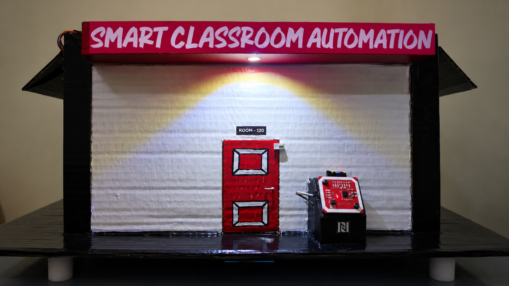
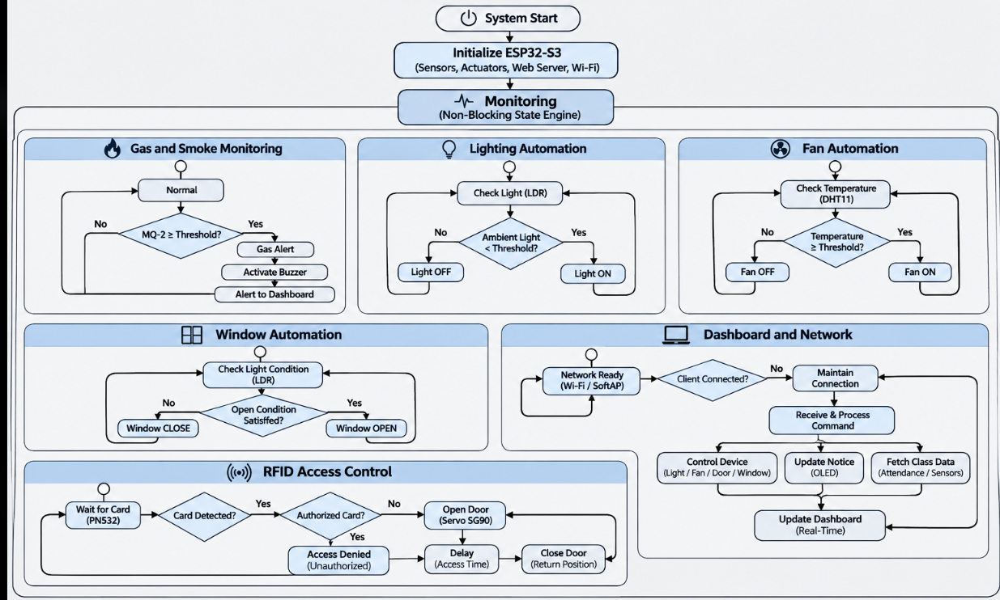
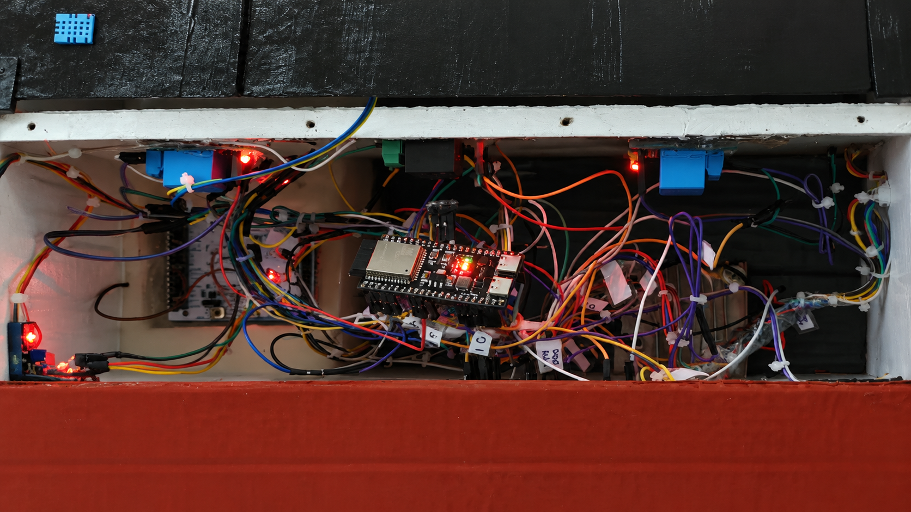
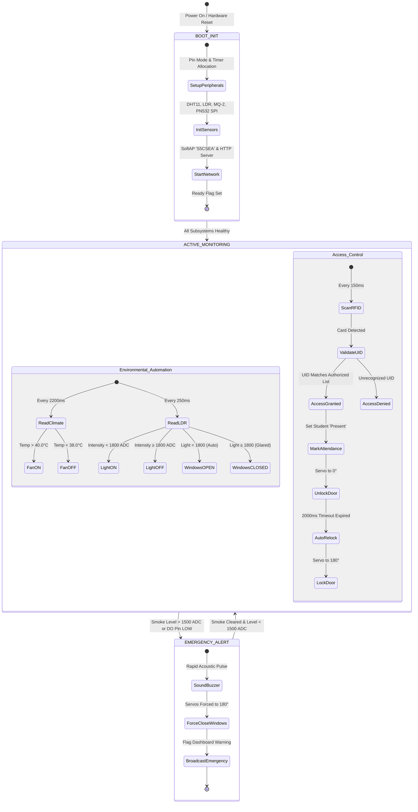
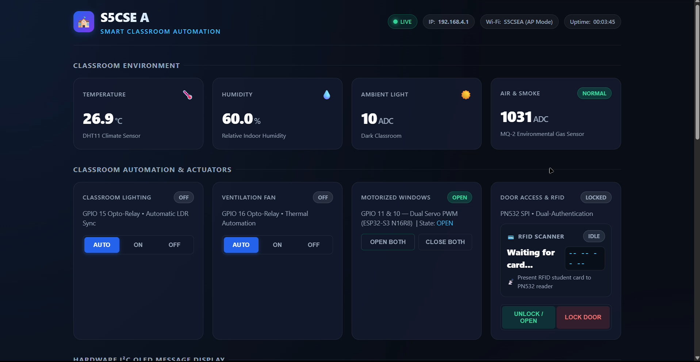
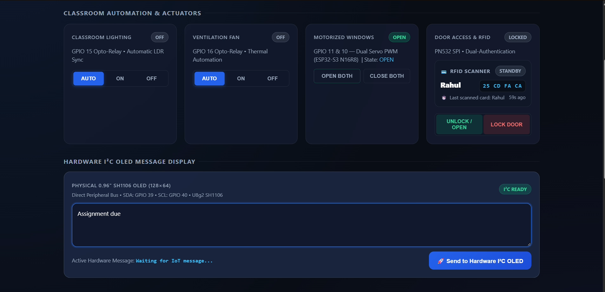
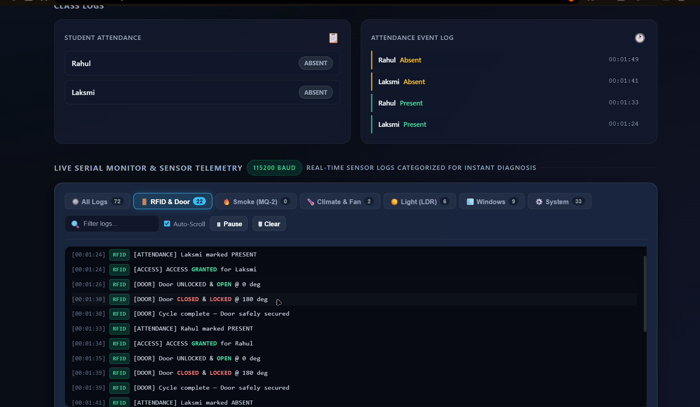

<div align="center">

# 🏫 SmartClassroom Automation
### *Comprehensive Embedded IoT Management, Access Control & Environmental Safety System*

<br>

<p align="center">
  
</p>
<p align="center"><em>Figure 1: Smart Classroom Automation physical scale model (Room 120) featuring automated door access, ambient lighting, dual-window actuation, and RFID terminal.</em></p>

<br>

[-E7352C?style=for-the-badge&logo=espressif&logoColor=white)](https://www.espressif.com/)
[](https://www.arduino.cc/)
[](http://192.168.4.1)
[-F7DF1E?style=for-the-badge&logo=javascript&logoColor=black)](http://192.168.4.1)
[](LICENSE)

<br>

[Executive Summary](#1-executive-summary) • [System Architecture](#2-system-architecture) • [Wiring & Hardware](#3-hardware-specification--wiring) • [State Transitions](#4-working-principle--state-transitions) • [IoT Implementations](#5-iot-implementations--dashboard) • [Code Architecture](#6-firmware--code-architecture) • [Quick Start](#7-deployment--quick-start)

</div>

---

## 1. Executive Summary

The **SmartClassroom Automation System** is an end-to-end, edge-computing IoT solution engineered to modernize academic facilities. Traditional classrooms face significant operational overhead: manual paper attendance is time-consuming, lighting and ventilation remain switched on in empty rooms causing severe energy waste, and emergency detection often relies on independent, uncoordinated warning systems.

This project addresses these challenges with an integrated embedded architecture powered by the high-performance **ESP32-S3 N16R8 microcontroller**:
- **Automated Access & Attendance:** PN532 RFID reader tracks student card tap-ins, instantly updating digital attendance logs and controlling an SG90 servo door lock.
- **Climate & Energy Automation:** DHT11 temperature/humidity sensing and LDR ambient light sensors drive opto-isolated relays and motorized dual-servo windows without manual intervention.
- **Proactive Safety System:** An MQ-2 gas/smoke detector triggers an immediate acoustic alarm via buzzer, forces windows shut to isolate hazards, and flags emergency alerts across the network.
- **Edge-Hosted Web Dashboard:** An asynchronous single-page web interface served directly from the ESP32-S3 flash memory delivers sub-second telemetry, manual actuator overrides, live serial logging, and remote OLED notice dispatching — accessible via any mobile phone or PC browser without cloud dependency.

---

## 2. System Architecture

The system is organized into a four-tier architecture spanning physical sensing, edge processing, real-time actuation, and network presentation:

<p align="center">
  
</p>
---

## 3. Hardware Specification & Wiring

The complete circuitry connects directly to the ESP32-S3 peripheral bus. Opto-isolated relay modules isolate high-power loads (lighting fixtures, ventilation fans) from the microcontroller digital pins.

<div align="center">

<p align="center">
  
</p>
<p align="center"><em>Figure 2: Internal hardware wiring, ESP32-S3 breakout board, relay modules, sensor harness, and actuator power distribution.</em></p>

</div>

### 3.1 Hardware Components Bill of Materials

| Component | Specification | Interface | Purpose |
|:---|:---|:---:|:---|
| **ESP32-S3 Dev Module** | Xtensa Dual-Core 240MHz, 16MB Flash, 8MB PSRAM | Core SoC | Master controller, Wi-Fi server, state machine |
| **PN532 NFC/RFID Module** | 13.56 MHz High-Frequency Reader | SPI | Student identification & door access authentication |
| **DHT11 Sensor** | 0–50°C (±2°C), 20–90% RH (±5%) | 1-Wire Digital | Classroom climate and temperature monitoring |
| **LDR Sensor Module** | Photoresistor with analog comparator | Analog ADC | Ambient light measurement & daylight tracking |
| **MQ-2 Gas / Smoke Sensor** | Flammable Gas, LPG, Smoke detector | Analog ADC + DO | Environmental hazard and fire prevention |
| **SG90 Micro Servos (x3)** | 9g Analog Servo, 1.8 kg·cm torque | PWM | 1x Door deadbolt mechanism, 2x Dual window louvers |
| **2-Channel Relay Module** | 5V Opto-isolated, 10A 250VAC ratings | Active LOW | Switching classroom light fixture and ventilation fan |
| **SH1106 OLED Display** | 0.96" Monochrome 128×64 matrix | I2C (0x3C) | Local classroom information & digital notice board |
| **Piezo Buzzer** | 5V Active Sounder | Digital Output | Emergency audible evacuation alarm |

### 3.2 GPIO Pin Mapping Reference

| ESP32-S3 GPIO | Connected Peripheral | Signal Type | Logic / Operating Level |
|:---:|:---|:---:|:---|
| **GPIO 1** | LDR Photoresistor | Analog Input | 12-bit ADC (0–4095) |
| **GPIO 4** | DHT11 Climate Sensor | Digital Bidirectional | Single-bus data line with pull-up |
| **GPIO 5** | MQ-2 Smoke Sensor (AO) | Analog Input | 12-bit ADC concentration level |
| **GPIO 6** | MQ-2 Smoke Sensor (DO) | Digital Input | Active-LOW digital trigger threshold |
| **GPIO 7 / 38** | Audible Alarm Buzzer | Digital Output | Active-HIGH acoustic pulse |
| **GPIO 10** | Window Servo 1 (Left) | PWM Output | ESP32PWM timer (0° Open, 180° Closed) |
| **GPIO 11** | Window Servo 2 (Right)| PWM Output | ESP32PWM timer (0° Open, 180° Closed) |
| **GPIO 12** | PN532 RFID SS (Chip Select) | SPI Output | Slave Select line |
| **GPIO 13** | PN532 RFID MOSI | SPI Output | Master Out Slave In |
| **GPIO 14** | PN532 RFID SCK | SPI Output | Serial Clock |
| **GPIO 20** | PN532 RFID MISO | SPI Input | Master In Slave Out |
| **GPIO 15** | Classroom Light Relay | Digital Output | Active-LOW opto-isolated trigger |
| **GPIO 16** | Ventilation Fan Relay | Digital Output | Active-LOW opto-isolated trigger |
| **GPIO 18** | Door Access Servo | PWM Output | ESP32PWM timer (0° Unlocked, 180° Locked) |
| **GPIO 39** | SH1106 OLED SDA | I2C Data | Direct 400 kHz fast I2C bus |
| **GPIO 40** | SH1106 OLED SCL | I2C Clock | Direct 400 kHz fast I2C bus |

---

## 4. Working Principle & State Transitions

The system firmware functions as a deterministic **cooperative finite state machine (FSM)**. Rather than relying on blocking delays (`delay()`), each subsystem executes periodic non-blocking sampling using `millis()` timing counters.



### Operational Logic & Safety Precedence
1. **Safety Interlock Priority:** Smoke and gas hazards override all environmental preferences. If `smokeLevel > 1500 ADC` or the MQ-2 digital comparator trips, both window servos immediately lock closed (`180°`) to prevent external draught propagation, and the acoustic buzzer engages continuously.
2. **Climate Hysteresis:** The ventilation fan turns **ON** when ambient temperature exceeds $40.0^\circ\text{C}$ and turns **OFF** only after cooling below $38.0^\circ\text{C}$, preventing rapid relay chatter.
3. **Lighting Automation:** The classroom lighting turns **ON** when ambient light drops below $1800\text{ ADC}$ (simulating low natural daylight) with a $100\text{ ADC}$ hysteresis buffer.
4. **Door Security Cycle:** Upon successful NFC badge verification, the door deadbolt servo sweeps from $180^\circ$ (Locked) to $0^\circ$ (Open). An internal 2-second timer (`DOOR_OPEN_TIME`) triggers an automatic return to $180^\circ$ to maintain room perimeter security.

---

## 5. IoT Implementations & Dashboard

The embedded HTTP server delivers a modern, high-contrast, responsive single-page application (SPA). Optimized for mobile devices, tablets, and desktop workstations, the dashboard offers complete oversight and bidirectional hardware management.

### 5.1 Real-Time Environmental Telemetry & Actuator Controls

The primary telemetry dashboard gives instantaneous feedback on indoor conditions alongside manual and automated actuator toggles:

<div align="center">

<p align="center">
  
</p>
<p align="center"><em>Figure 3: Live telemetry cards showing Temperature (26.9°C), Humidity (60.0%), Ambient Light (10 ADC), Air Quality (1031 ADC / Normal), and actuator toggles.</em></p>

</div>

- **Environmental Telemetry:** Displays calibrated data streams from the DHT11 and MQ-2 sensors with colored condition badges (`NORMAL`, `ALERT`).
- **Dual-Mode Actuators:** Lights and ventilation fans can be switched between **AUTO** (sensor-governed) and **MANUAL** (user override) states with immediate relay response.
- **Synchronized Window Servos:** Motorized dual windows support single-click `OPEN BOTH` or `CLOSE BOTH` commands powered by hardware PWM.

---

### 5.2 RFID Dual-Authentication & Hardware OLED Messaging

Access control and remote digital notices are unified within an intuitive management card:

<div align="center">

<p align="center">
  
</p>
<p align="center"><em>Figure 4: RFID scanner telemetry card detailing authenticated cardholder info and the real-time hardware OLED message dispatcher.</em></p>

</div>

- **RFID Badge Recognition:** Displays the last scanned cardholder name, 4-byte hexadecimal UID (`25 CD FA CA`), and scan latency.
- **Manual Door Override:** Instant `UNLOCK` and `LOCK DOOR` controls for authorized faculty.
- **Physical OLED Dispatcher:** Allows administrators to draft and transmit custom announcements (e.g., *"Assignment due tomorrow"*) over Wi-Fi directly to the physical 0.96" SH1106 OLED screen in the classroom.

---

### 5.3 Automated Student Attendance & Diagnostic Telemetry Logger

The lower section of the interface functions as a digital attendance register and live serial telemetry monitor:

<div align="center">

<p align="center">
  
</p>
<p align="center"><em>Figure 5: Live student attendance status grid (Rahul, Laksmi) and real-time categorized 115200 Baud diagnostic serial event logger.</em></p>

</div>

- **Digital Attendance Ledger:** Color-coded status badges track student presence in real time (`PRESENT` in green, `ABSENT` in red) with exact clock timestamps.
- **Categorized Event Telemetry:** An integrated 115200 Baud serial terminal logs system events into dedicated diagnostic tabs (`All Logs`, `RFID & Door`, `Smoke`, `Climate & Fan`, `Light`, `Windows`, `System`).
- **Audit Logging:** Every physical action (e.g., `[ATTENDANCE] Rahul marked PRESENT`, `[DOOR] Cycle complete — Door safely secured`) is recorded with microsecond system timestamps.

---

## 6. Firmware & Code Architecture

The firmware codebase is structured modularly for readability, maintainability, and rapid feature extension:

```
Smart_class/
├── SmartClassroom.ino         # Primary sketch: setup(), main loop & task scheduling
├── config/
│   ├── pins.h                 # Master GPIO pin definitions & peripheral assignments
│   ├── thresholds.h           # Operational setpoints (40°C fan, 1800 ADC light, 1500 gas)
│   └── device_config.h        # Student RFID whitelist (Rahul, Laksmi), AP credentials
├── core/
│   ├── systemstate.h          # Central shared state data structure & JSON serialization
│   └── logger.h               # Circular buffer logger with topic-based categorization
├── door/                      # PN532 SPI reader driver, student lookup & servo door locking
├── dht_fan/                   # DHT11 climate reading & hysteresis fan relay control
├── ldr_light/                 # LDR photoresistor ADC sampling & lighting relay logic
├── window/                    # Dual SG90 servo synchronization for motorized louvers
├── smoke/                     # MQ-2 analog/digital gas sensing & safety buzzer triggers
├── oleddisplayiot/            # SH1106 128x64 U8g2 driver & dynamic notice renderer
├── network/
│   ├── wifi_manager.h         # Dual-mode Wi-Fi (SoftAP 'S5CSEA' + Station auto-connect)
│   ├── captiveportal.h        # DNS server for automatic mobile browser redirection
│   └── httpserver.h           # WebServer routing REST API endpoints & serving dashboard
└── dashboard/                 # PROGMEM-compiled HTML5, CSS3, and JavaScript assets
```

### 6.1 Core REST API Endpoints

| HTTP Method | Route | Description | Sample JSON Response / Action |
|:---:|:---|:---|:---|
| `GET` | `/` | Serves dashboard single-page application | HTML5 markup from flash memory |
| `GET` | `/api/status` | Comprehensive classroom state payload | `{"temperature":26.9,"humidity":60,"lightIntensity":10,...}` |
| `GET` | `/api/environment` | Environmental metrics | `{"temperature":26.9,"humidity":60.0,"smokeLevel":1031}` |
| `POST`| `/api/light` | Switch lighting mode | Argument: `mode=manual_on`, `mode=auto` |
| `POST`| `/api/fan` | Switch ventilation fan mode | Argument: `mode=manual_on`, `mode=auto` |
| `POST`| `/api/window` | Actuate window servo positions | Argument: `action=open`, `action=close` |
| `POST`| `/api/door` | Unlock or lock classroom door | Argument: `action=unlock`, `action=lock` |
| `POST`| `/api/oled` | Dispatch text notice to OLED display | Form parameter: `message=Assignment due` |
| `GET` | `/api/logs` | Fetch system audit events | JSON array of timestamped log entries |

---

## 7. Technical Specifications

| Parameter | Specification | Details |
|:---|:---|:---|
| **Microcontroller Platform** | Espressif ESP32-S3-WROOM-1 | Xtensa Dual-Core 32-bit LX7 @ 240 MHz |
| **On-Chip Memory** | 16 MB Flash, 8 MB Octal PSRAM | Stores firmware, web dashboard, and ring buffers |
| **Wi-Fi Connectivity** | 802.11 b/g/n (2.4 GHz) | Default SoftAP: `S5CSEA` (Open / 192.168.4.1) |
| **mDNS Domain** | `http://smartclassroom.local` | Zero-configuration local name resolution |
| **RFID Frequency** | 13.56 MHz (ISO/IEC 14443A) | Compatible with Mifare Classic & NFC tags |
| **Relay Switching Capacity** | 10A 250VAC / 10A 30VDC | Opto-isolated high voltage safety boundary |
| **Telemetry Refresh Rate** | 1000 ms periodic polling | Sub-second telemetry sync over HTTP REST |
| **Door Unlock Duration** | 2000 ms auto-relock | Automatic security reset after passage |
| **Safety Alarm Level** | > 85 dB @ 10 cm | High-visibility emergency acoustic alert |

---

## 8. Deployment & Quick Start

### 8.1 Hardware Prerequisites
1. Assemble all sensors, servos, relays, and display according to the [GPIO Pin Mapping](#32-gpio-pin-mapping-reference).
2. Connect external 5V power supply to servos and relays (ensure common ground with the ESP32-S3).

### 8.2 Firmware Compilation & Flashing
1. **Toolchain Setup:** Install [Arduino IDE](https://www.arduino.cc/en/software) (version 2.x+) or [PlatformIO](https://platformio.org/).
2. **ESP32 Board Support:** Add the Espressif board manager URL:
   ```
   https://raw.githubusercontent.com/espressif/arduino-esp32/gh-pages/package_esp32_index.json
   ```
3. **Install Required Libraries via Library Manager:**
   - `ESP32Servo` by Kevin Harrington
   - `Adafruit PN532` by Adafruit
   - `DHT sensor library` by Adafruit
   - `U8g2` by oliver
   - `ArduinoJson` by Benoît Blanchon
4. **Configuration:**
   - Open `SmartClassroom.ino`.
   - Edit [`config/device_config.h`](config/device_config.h) to register student names and their respective 4-byte RFID card UIDs:
     ```cpp
     static AuthorizedUser authorizedUsers[] = {
         { {0x25, 0xCD, 0xFA, 0xCA}, 4, "Rahul", false },
         { {0x35, 0xE5, 0xF7, 0xCA}, 4, "Laksmi", false }
     };
     ```
5. **Board Configuration:**
   - **Board:** `ESP32S3 Dev Module`
   - **Flash Size:** `16MB (128Mb)`
   - **Partition Scheme:** `16M Flash (3MB APP/9.9MB FAT)`
   - **PSRAM:** `OPI PSRAM`
6. Click **Upload** to compile and program the firmware.

### 8.3 Connecting to the Dashboard
1. On your smartphone or laptop, open Wi-Fi settings and connect to the wireless network:
   - **SSID:** `S5CSEA`
   - **Password:** *(None - Open Network)*
2. A captive portal popup will appear automatically. Alternatively, launch any browser and navigate to:
   ```
   http://192.168.4.1
   ```
   *(or `http://smartclassroom.local` if connected via local router station mode)*.
3. Tap an authorized RFID card on the reader to test automated attendance and door unlocking.

---

## 9. Conclusion & Academic Significance

The **SmartClassroom Automation** system proves that an industrial-grade, multi-functional classroom automation platform can be deployed on a cost-effective, self-contained edge microcontroller. By removing cloud service dependence, the design guarantees zero recurring operational costs, immunity to external internet outages, and strict privacy protection for student attendance data. 

The modular firmware architecture enables effortless expansion to support multi-room networks, ambient energy harvesting, and advanced environmental analytics.

---

<div align="center">

**Developed for S5CSE A — Smart Classroom Project**  
*ESP32-S3 N16R8 Edge Embedded System*

<br>

[](#)
[](#)

</div>
